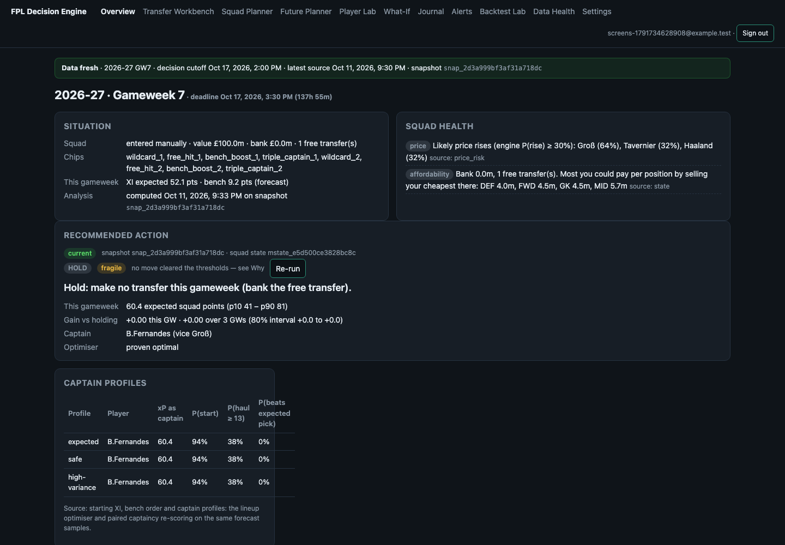
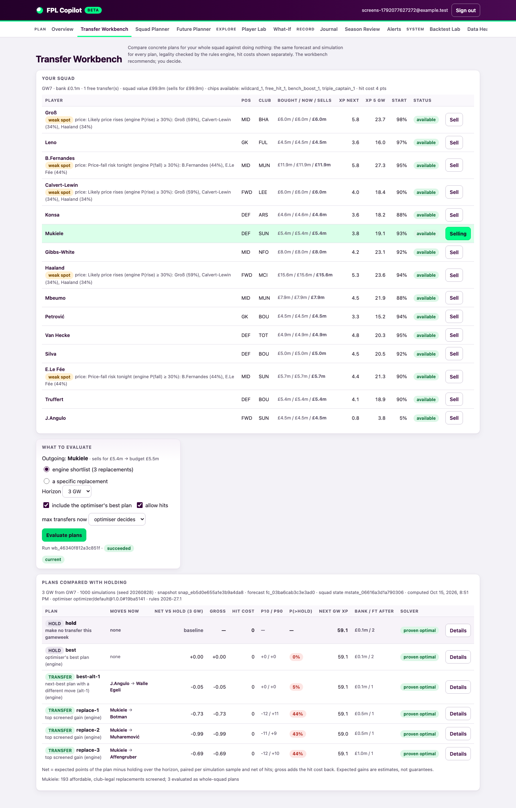
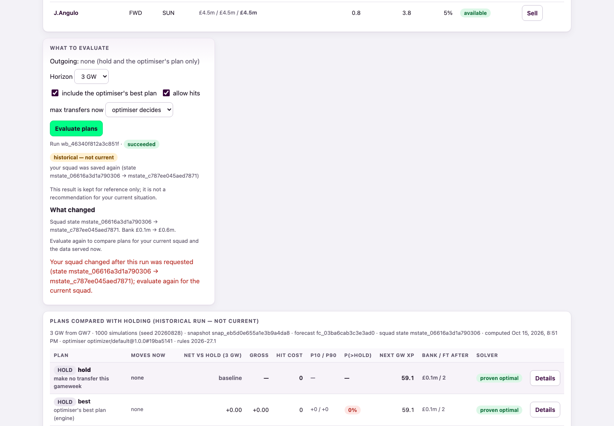
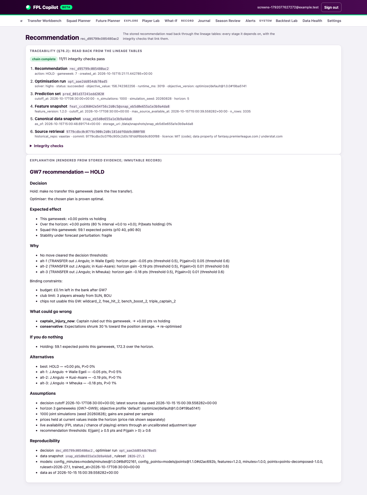
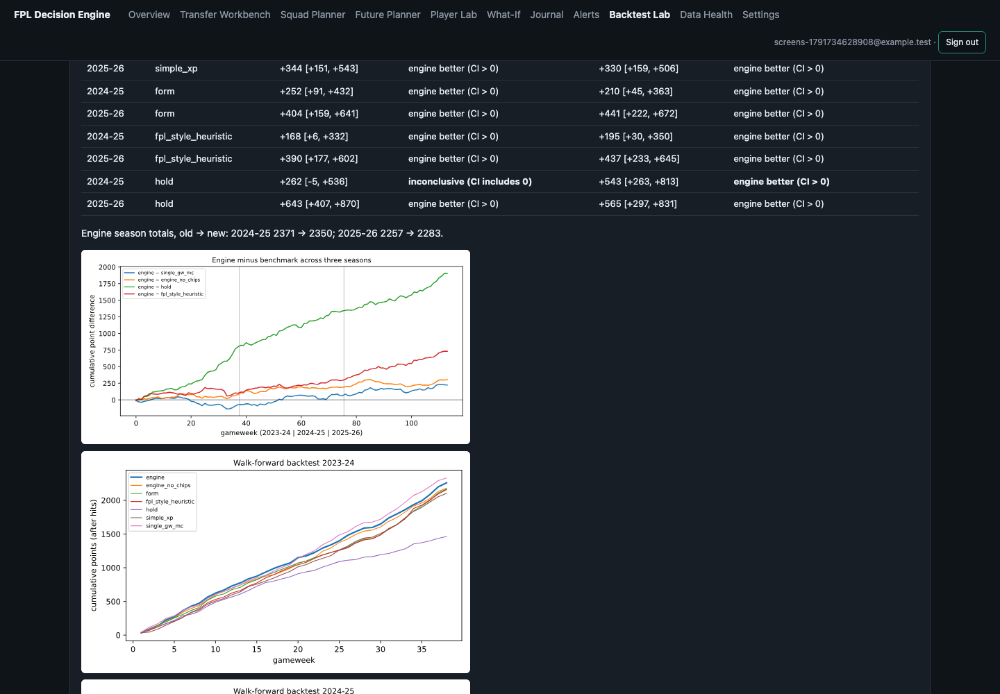
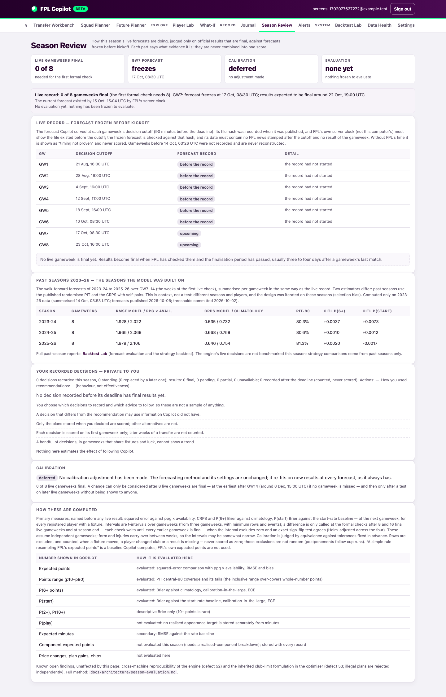
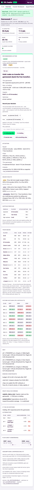
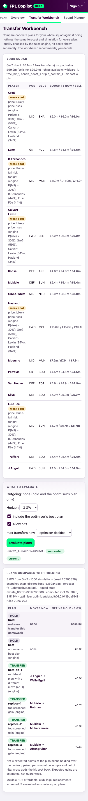

# FPL Copilot

[](https://github.com/adivishall/fpl-copilot/actions/workflows/ci.yml?query=branch%3Adevelop)


[](LICENSE)

**A probabilistic decision engine for Fantasy Premier League managers: it forecasts every
player's points as a distribution, plans legal transfers across several gameweeks, compares each
plan with doing nothing, and tells you when an answer is no longer current.**

Every week an FPL manager decides whether to transfer, take a points hit, play a chip and who to
captain — under uncertain minutes, injuries, fixtures and prices, with rules (budget, selling
prices, club limits, banked transfers) that make "the best player" the wrong question. Most tools
give one expected-points number per player and a "best transfer". FPL Copilot starts from the
manager's real squad and state, simulates outcomes jointly, optimises the whole squad over the
coming gameweeks, checks every plan against the rules independently, and shows the evidence,
the downside and what happens if you do nothing.

> **Status:** active development — milestone M1.6 (FPL Copilot design system) complete; the
> first live-season evidence (the GW7 forecast checkpoint) is captured after 2026-10-17 08:30 UTC.
> The full production topology (TLS proxy, web, API, worker, scheduler, PostgreSQL, Redis) is
> verified **locally** with Docker Compose. **There is no public demo yet.**

[](docs/images/copilot-home-full.png)

<sub>Screenshots are from the locally deployed stack with a squad built by the optimiser (no real
manager's data). FPL Copilot is an independent tool: it is not affiliated with or endorsed by the
Premier League or Fantasy Premier League.</sub>

## What it does today

| For the manager | How |
|---|---|
| **Import your real squad** with your FPL ID (public data only — never your FPL password), or enter it manually | squad, bank, purchase prices and chips from the official API; invite-only accounts own their managers |
| **Copilot Home**: situation, squad health signals, recommended action, captain profiles, fixture outlook | an analysis the worker precomputes per squad and data snapshot |
| **Player forecasts with uncertainty** | minutes, start probability and a full points distribution per player and gameweek (p10–p90), not a single number |
| **Captaincy and transfer decisions** — HOLD, TRANSFER, HIT or CHIP | every candidate plan is scored against *holding* on the same simulated samples; a move must clear a minimum expected gain and a probability of beating HOLD |
| **Transfer Workbench**: compare your own transfer, the engine's replacements for a player and the optimiser's best plan, for the whole squad | each option solved as a full multi-gameweek plan; hit costs shown separately from gross gains; solver status shown |
| **Multi-gameweek planning** (1–5 gameweeks served; the evaluated forecast horizon) | mixed-integer optimisation over budget with exact selling prices, banked free transfers, hits, both chip sets, captain and bench |
| **Risk and downside** | p10 / p90 of the gain, "what could go wrong" scenarios, stability of the choice under forecast perturbations |
| **Rules you can trust** | an independent validator replays every plan through the FPL rules; illegal plans are never recommended |
| **"Is this still current?"** | every recommendation and workbench run says whether it is current or historical — a newer data snapshot was promoted, or the squad was saved again — and **What changed?** shows the actual differences (players, availability, news, prices, fixtures, forecast versions) from stored data |
| **Decision journal**: what Copilot recommended, what you decided, what happened, and how that compares with what was expected | record a decision from Home or the Workbench (follow, hold, another plan, a different captain, decide later); the decision-time evidence is frozen with it; after the gameweek your action, HOLD and the recommended plan are scored on official results — final only when FPL finalises the gameweek, never graded from one outcome |
| **Season Review**: how the live forecasts are doing this season, judged only on final official results | the forecast served at each gameweek's decision cutoff is frozen — its file hash, data export time and promotion recorded in the database before the cutoff, and its data checked for later FPL news or results — scored against simple baselines with per-gameweek intervals — verdicts only after 8 final live gameweeks — beside the past seasons over the same weeks and, privately, your own recorded decisions; nothing is recalibrated automatically |
| **Traceability** | any recommendation walks back to the optimisation run, prediction run, feature snapshot, data snapshot and pinned source revision |
| **Background processing** | recommendations and plan comparisons run as worker jobs (tens of seconds); the page never blocks on a solve |

<table>
  <tr>
    <td width="50%"><a href="docs/images/transfer-workbench.png"></a><br><sub><b>Transfer Workbench</b> — your transfer, the engine's replacements and the optimiser's plans, each against holding, with hit costs, risk and solver status.</sub></td>
    <td width="50%"><a href="docs/images/what-changed.png"></a><br><sub><b>What changed?</b> — a run whose squad was saved again is marked historical, with the stored difference.</sub></td>
  </tr>
  <tr>
    <td width="50%"><a href="docs/images/traceability.png"></a><br><sub><b>Traceability</b> — recommendation → optimisation run → prediction set → feature snapshot → data snapshot → source revision.</sub></td>
    <td width="50%"><a href="docs/images/backtest-lab.png"></a><br><sub><b>Backtest Lab</b> — walk-forward evaluation against six benchmark strategies.</sub></td>
  </tr>
  <tr>
    <td width="50%"><a href="docs/images/season-review.png"></a><br><sub><b>Season Review</b> — the live record (nothing frozen before the first cutoff), the past seasons over the same weeks, and the calibration state.</sub></td>
    <td width="50%"><a href="docs/images/copilot-home-mobile.png"></a> <a href="docs/images/transfer-workbench-mobile.png"></a><br><sub><b>On a phone</b> — the same pages at 390 px; wide tables scroll sideways instead of breaking the layout.</sub></td>
  </tr>
</table>

Also: alerts with materiality thresholds (deadline, availability, price risk, plan invalidation),
a Backtest Lab and a data-health page.

**Not built yet** (roadmap, `docs/PRODUCT_GAP_ANALYSIS.md`): any recalibration of the live
models (measurement only until 8 live gameweeks are final), mini-league strategy, a
conversational assistant and a browser extension.

## How it works

```mermaid
flowchart LR
  A[FPL API<br/>+ pinned historical archive] --> B[Ingestion<br/>contracts · quality gates]
  B --> C[(PostgreSQL<br/>canonical data · lineage)]
  C --> D[Snapshot<br/>content-hashed, point-in-time]
  D --> E[Forecasts<br/>minutes · rates · team strength]
  E --> F[Joint Monte Carlo<br/>1,000 samples]
  F --> G[MILP planner<br/>HiGHS]
  G --> H[Independent<br/>rules validator]
  H --> I[Decision engine<br/>vs HOLD · risk · chips]
  I --> J[FastAPI + worker jobs<br/>Redis / RQ]
  J --> K[Next.js web app]
```



1. **Data.** Live FPL captures and a pinned historical archive are ingested through typed
   contracts and quality gates; every observation keeps its *availability* time, and each data
   snapshot is content-addressed, so a result can name exactly what it saw.
2. **Forecasts.** Calibrated minutes models, shrunk per-90 rates and a team-strength model feed a
   joint simulation of goals, assists, clean sheets, saves, defensive contributions, cards and
   bonus, scored with the season's versioned rules.
3. **Plans.** A mixed-integer program plans the squad over the horizon; every returned plan is
   replayed by an independent validator; the decision engine compares the best plan, HOLD and
   alternatives on the *same* samples.
4. **Serving.** FastAPI serves results; a worker computes forecasts, recommendations and
   workbench runs as jobs; a scheduler refreshes live data hourly and promotes a new snapshot
   only once its forecast is ready; results judged against older inputs are marked historical.
5. **Web.** The browser talks only to the Next.js server, which proxies the API with a key the
   browser never sees.

Deeper: [optimiser](docs/architecture/optimizer.md) · [result lifecycle](docs/architecture/result-lifecycle.md) ·
[database schema](docs/architecture/database-schema.md) · [rules verification](docs/architecture/rules-verification.md) ·
[architecture decisions](docs/decisions/) · [API](docs/API.md).

## Engineering highlights

* **Point-in-time evaluation.** Backtests replay three seasons week by week with only what was
  known before each deadline. A schedule look-ahead (postponed fixtures visible early in
  archived data) was found and fixed, and the published numbers were regenerated —
  [backtest protocol](docs/BACKTEST_PROTOCOL.md).
* **Uncertainty, not point estimates.** Distributions are evaluated with CRPS and PIT coverage;
  pre-registered promotion gates; [model card](docs/MODEL_CARD.md).
* **Optimisation under real constraints** — budget with selling prices, club limits, free-transfer
  banking, hits, chip windows, Free Hit reversion — with an independent validator and a
  brute-force-checked MILP ([optimiser](docs/architecture/optimizer.md),
  [benchmark](ml/reports/optimizer_benchmark.md)). Plans are labelled *proven optimal* only when
  the solver proved it.
* **Prospective evaluation without hindsight.** A recorded decision keeps the evidence it was
  made on (plans, lineups, expectations, identifiers), pre-deadline decisions cannot be replaced
  after the deadline, evaluations are insert-only and idempotent, and official corrections add
  a revision instead of overwriting ([design](docs/architecture/decision-journal.md)).
* **A live record, evaluated by a contract fixed in advance.** The forecast served at each
  decision cutoff is committed to (file hash) before it can be served, its existence before the
  cutoff is established by FPL's server clock rather than the host's, and it is frozen
  afterwards; it is scored only on final results, with the gameweek as the
  unit of evidence, intervals, an exact sign-flip test and verdicts only at predeclared looks
  ([evaluation contract](docs/architecture/season-evaluation.md)).
* **Result lifecycle.** Recommendations and workbench runs are judged against the promoted data
  snapshot; promotion invalidates older results idempotently, late or out-of-order jobs never
  replace newer answers, and "What changed?" is built from stored inputs only, never invented
  ([design](docs/architecture/result-lifecycle.md)).
* **Security.** Invite-only accounts (scrypt, hashed HttpOnly sessions), ownership checked for
  every manager key a request names, hashed API keys in two privilege classes, SSRF-guarded
  webhooks, rate limits, export and erasure ([deployment](docs/DEPLOYMENT.md), [security policy](SECURITY.md)).
* **Lineage.** Recommendation → optimisation run → prediction run → feature snapshot → data
  snapshot → source revision, with integrity checks.
* **Operations.** Docker Compose stack with health checks, atomic publication of job results,
  classified job failures, snapshot retention, backups tested by a full restore, Prometheus
  metrics and alert rules; CI runs lint, types, layering contracts, tests, an optimiser suite,
  browser flows, dependency and secret scans and container builds on every push.

## Evidence

All figures link to the generated reports; development-machine timings come from one Apple M4.

**Forecasts** — out of sample over 114 weekly cutoffs in three seasons
([report](ml/reports/forecast_eval.md)):

| horizon 0, all players | Monte Carlo model | best simple baseline | climatology |
|---|---|---|---|
| RMSE (points) | **1.924** | 2.031 (paired 95 % CI of the difference excludes 0) | 2.351 |
| CRPS | **0.628** | — | 0.722 |
| central 80 % interval coverage (randomised PIT) | **0.804** | — | 0.800 |
| P(start) Brier / ECE | **0.083 / 0.011** | 0.101 / 0.021 | — |

**Decisions** — walk-forward backtest, 114 gameweeks, engine minus benchmark with 95 %
season-stratified bootstrap CIs ([report](ml/reports/backtest.md)):

| vs | difference | 95 % CI | reading |
|---|---|---|---|
| never transfer (`hold`) | +1905 | [+1454, +2381] | better |
| `form` | +742 | [+391, +1076] | better |
| FPL-style heuristic | +732 | [+369, +1094] | better |
| expected-points greedy (`simple_xp`) | +626 | [+311, +956] | better |
| same engine without chips | +306 | [+28, +593] | better, barely |
| same forecast, one-week optimiser | +223 | [−126, +584] | **inconclusive** |

The evidence supports "probabilistic forecasting + optimisation beats simple heuristics". It does
**not** show that multi-gameweek planning beats a one-week optimiser on the same forecast, and
most single-season comparisons are inconclusive. No rank claims: the archive has no distribution
of other managers' scores.

**Optimiser** ([benchmark](ml/reports/optimizer_benchmark.md); 48 real squad states, 612 solves):
100 % of 634 returned plans pass independent validation; 5-GW transfer plans p50 3.9 s / p95
13.4 s; the MILP beats a greedy one-transfer heuristic in 94 % of states; chip-open solves always
reach the 60 s limit and are labelled *not proven optimal*.

**Tests** (current branch, development machine; [build status](docs/BUILD_STATUS.md)):

| suite | result |
|---|---|
| Python fast tier — unit, property and integration tests on real PostgreSQL and Redis | 453 passed |
| slow + network tiers — official points on 113,870 historical rows; rules vs the live FPL API | 6 passed |
| browser flows, development stack (incl. a real snapshot promotion) | 13 passed |
| browser flows, production topology on the Docker Compose stack (web proxy → API → worker; live FPL-ID import) | 22 passed |
| ruff, mypy (116 files), import-linter (4 contracts), TypeScript, `next build` | clean |

**Open findings** (disclosed, not hidden):
* *Cross-machine reproducibility* — the engine reproduces itself byte-for-byte on one machine,
  but different CPUs (and even shared CI runners) produce slightly different forecasts and
  plans. The byte-exact golden test runs on the development platform; CI checks run-to-run
  self-consistency and uploads its output for comparison, but gives no cross-platform guarantee.
* *Inherited club excess* — with more players from one club than the limit (possible after a
  mid-season transfer), the optimiser can propose a plan the validator rejects; the validator
  blocks it and the fallback is labelled "best valid plan among those explored; not proven
  optimal". The formulation fix is open.

## Run it locally

Prerequisites: Docker with Compose (the stack was verified on a 4-vCPU Docker VM),
[uv](https://docs.astral.sh/uv/) with Python 3.12, and Node.js 22 for the web build and browser
tests. The first data load downloads the pinned historical archive and calls the live FPL API.

```bash
git clone https://github.com/adivishall/fpl-copilot.git && cd fpl-copilot
cp .env.example .env    # then set POSTGRES_PASSWORD (and the same password in FPL_DATABASE_URL)
```

Generate two API keys — an operator key and the web server's key — and put their **hashes** in
`.env` (`FPL_API_KEYS_SHA256`, `FPL_WEB_API_KEYS_SHA256`) and the web key itself in
`FPL_WEB_API_KEY`:

```bash
docker compose run --rm api fpl-api create-key    # run twice; prints a key and its hash
```

Start the databases, apply migrations, load the historical data and precompute the forecast:

```bash
docker compose up -d postgres redis
docker compose run --rm migrate
docker compose run --rm scheduler fpl-ingest historical --all
docker compose run --rm scheduler fpl-ingest export-snapshot
docker compose up -d
docker compose run --rm scheduler fpl-worker run-once forecast_precompute   # 1–3 minutes
```

Check it and open the app:

```bash
curl -s -H "x-api-key: <operator key>" http://localhost:8000/api/v1/health
docker compose run --rm api fpl-api create-invite   # an invitation code to register with
```

Then open <http://localhost:3000>, register with the invitation, and import your team with your
FPL ID. The web app is on `:3000`, the API on `:8000` (both bound to localhost).

Tests and checks:

```bash
uv sync --frozen
make ci                                  # ruff, mypy, import-linter, fast tests
uv run pytest -m "slow or network"       # needs the historical download and internet access
cd apps/web && npm ci && npm run build && npx playwright test   # development browser flows
```

Stop with `docker compose down` (data stays in the named volumes; `down -v` deletes it).
Troubleshooting — `503 forecast not ready` after a new snapshot (run the `forecast_precompute`
step), key or session errors, live-source failures, backups and restore: see
[docs/DEPLOYMENT.md](docs/DEPLOYMENT.md).

## Status and roadmap

* **Done:** data pipeline and point-in-time evaluation; forecasting and simulation; MILP planner
  and validator; decision engine with risk, chips and scenarios; API, worker, scheduler and web
  app; invite-only accounts and FPL-ID onboarding (M1.1a); Transfer Workbench (M1.2); result
  lifecycle and "What changed?" (M1.3); decision journal with prospective outcome evaluation
  (M1.4); forecast record and Season Review with the live-season evaluation contract (M1.5).
* **Next:** the first formal live look after 8 final live gameweeks (GW7–14 of 2026-27), then any
  calibration change only through a shadow test on later live gameweeks.
* **Not done:** a public deployment (it needs a host, a domain and secrets); mini-league
  strategy, an assistant and a browser extension; live evidence on 2026-27 starts at GW7 and is
  not yet final.
* **Known limitations:** [docs/KNOWN_LIMITATIONS.md](docs/KNOWN_LIMITATIONS.md) — e.g. heavy
  requests take tens of seconds, timings come from one machine, the availability model is
  uncalibrated, and the design was iterated on the evaluated seasons.

Progress record: [docs/BUILD_STATUS.md](docs/BUILD_STATUS.md) · backlog:
[docs/BACKLOG.md](docs/BACKLOG.md) · changes: [CHANGELOG.md](CHANGELOG.md) ·
contributing: [CONTRIBUTING.md](CONTRIBUTING.md) · security: [SECURITY.md](SECURITY.md).

## License

[MIT](LICENSE). Fantasy Premier League data belongs to the Premier League; this project is not
affiliated with or endorsed by the Premier League or the FPL game.
